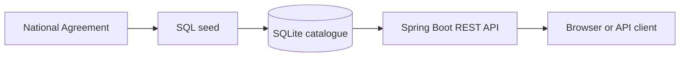

# Closing the Gap Outcome Tracker

## Introduction and goals

Closing the Gap Outcome Tracker is a project to make Australia's National Agreement targets and official progress figures easy to browse. The current Spring Boot API serves a catalogue of all 23 targets from SQLite. The planned release adds a public React tracker and a way for administrators to approve validated data imports.

| Goal | How to verify it | Status |
| --- | --- | --- |
| Cover the full Agreement | `GET /api/targets` returns 23 definitions with string IDs and official source links. | Verified |
| Show the published national figures | The July 2026 release covers 18 socio-economic targets with figures and 15 with progress assessments. | Planned |
| Import Target 8 without disrupting the live release | The importer identifies two national observations from the 2016 baseline onwards. A failed import leaves the approved release readable. | Planned |

## Architecture

The current catalogue starts with summaries of the National Agreement stored in SQL. Spring Boot reads the resulting SQLite file and returns JSON through the controller, service and repository layers.



The production release will serve React and the API from one Spring Boot application. A separate Java command will import official files into candidate releases in PostgreSQL. [SQLite catalogue decision](docs/adr/0001-serve-the-catalogue-from-a-snapshot.md) · [PostgreSQL release decision](docs/adr/0002-use-versioned-postgresql-releases.md)

## Contents

- [The data set](#the-data-set)
- [Constraints](#constraints)
- [Used tools](#used-tools)
- [Pipelines](#pipelines)
- [Demo](#demo)
- [What breaks](#what-breaks)
- [Conclusion](#conclusion)
- [Appendix](#appendix)

## The data set

The National Agreement defines 19 socio-economic targets and four Priority Reform targets. Their summaries and source links make up the current catalogue. The Productivity Commission's report from 29 July 2026 is the source for the planned national figures and progress assessments. [Targets and outcomes](https://www.closingthegap.gov.au/national-agreement/targets) · [Priority Reforms](https://www.closingthegap.gov.au/national-agreement/priority-reforms) · [July 2026 report and downloads](https://www.pc.gov.au/closing-the-gap-data/annual-data-report/2026/)

The checked-in catalogue is 24 KiB. The pinned Target 8 CSV is about 327 KiB and contains 863 data rows, including breakdowns and modelled figures. The first import will select the two national observations from the 2016 baseline onwards. [Target 8 CSV and verification](docs/development.md#stage-3--official-data-and-rest-api)

## Constraints

- The three-week release focuses on national headline figures and published assessments. The Javalin site provides the design and behaviour reference during the migration.
- Data availability varies by target. Target 9b keeps its definition and will show that figures are unavailable.
- The public demo is planned for a free hosting tier where feasible. Hosting limits and start-up behaviour need verification before deployment.

## Used tools

| Area | Current | Planned for the release |
| --- | --- | --- |
| Application | Java 21, Spring Boot MVC and Spring JDBC serve the catalogue. | Spring Security protects administrator approval. React, TypeScript and Vite provide the browser UI. |
| Data | SQLite serves a read-only snapshot of the 23 definitions. | PostgreSQL stores versioned releases. Flyway applies schema changes. |
| Verification and delivery | Maven Wrapper and two HTTP integration tests. | JUnit, Mockito, PostgreSQL Testcontainers, browser tests, GitHub Actions and a Docker image for the app. |

## Pipelines

The current seed scripts build the SQLite catalogue ahead of time. The API reads the file, and each `sourceUrl` points to the official page behind the definition. [Seed SQL](backend/src/main/resources/db/targets.sql) · [Repository query](backend/src/main/java/org/ctgtracker/repository/TargetRepository.java)

The planned batch job will read a downloaded Productivity Commission CSV, record the URL and checksum, validate the rows and write a candidate release. An administrator will approve the candidate before the API serves it. A failure during import leaves the active release readable. [Batch import and approval checks](docs/development.md#stage-3--official-data-and-rest-api)

## Demo

With JDK 21, start from the repository root and run the Spring Boot API locally.

```sh
cd backend
./mvnw -B clean verify &&
  java -jar target/ctg-outcome-tracker-0.1.0-SNAPSHOT.jar \
    --server.address=127.0.0.1 --server.port=8081
```

Open <http://127.0.0.1:8081/api/targets> to see the catalogue. The developer guide includes the health check, database queries and instructions for running Javalin side by side. A hosted demo and recorded walkthrough are part of the release plan. [Developer guide](docs/development.md)

## What breaks

- The current API needs the SQLite snapshot. Start the JAR from `backend/` so its default relative path resolves. [Local troubleshooting](docs/development.md#stage-1--spring-boot-foundation-and-ci)
- The Target 8 CSV mixes observations, counts and modelled figures. The import must check the series and unit before selecting values. A regression test will check that the 2026 trajectory stays out of the observations.
- An import can fail because an official file changes or contains unexpected rows. Candidate validation and explicit approval are the planned controls for keeping the live release available.

## Conclusion

The catalogue tests establish the API contract that the PostgreSQL migration needs to preserve. The next milestone is to run those checks in CI before changing the database. [Release roadmap](PLAN.md)

## Appendix

- [Developer guide](docs/development.md) for local setup, commands and expected results by stage.
- [Roadmap and review checklist](PLAN.md) for completion criteria and evidence.
- [Architecture decisions](docs/adr/) for the SQLite catalogue and planned PostgreSQL release workflow.

### Sources and credits

The target summaries are adapted from the National Agreement. © Commonwealth of Australia, Department of the Prime Minister and Cabinet. [Targets and outcomes](https://www.closingthegap.gov.au/national-agreement/targets) · [Priority Reforms](https://www.closingthegap.gov.au/national-agreement/priority-reforms) · [CC BY 4.0 terms](https://www.closingthegap.gov.au/copyright)

The original Javalin project is preserved at commit `285b983`. The RMIT University Studio Project starter code was written by Dr. Timothy Wiley and Prof. Santha Sumanasekara. Copyright RMIT University (c) 2021.

The structure of this README draws on Andreas Kretz's Data Engineering Cookbook. [README template](https://github.com/andkret/Cookbook/blob/master/Code%20Examples/template-readme.md)
